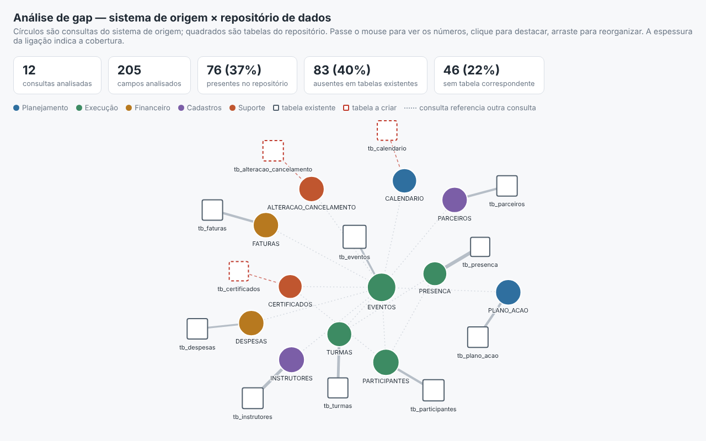
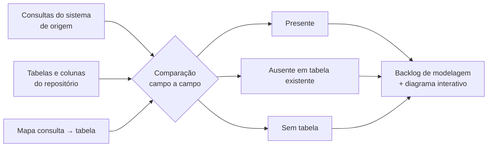

# 🧭 Análise de gap: sistema de origem × repositório de dados

Quanto do que o sistema operacional mostra já está guardado no repositório analítico? Este projeto responde campo a campo e transforma a resposta em backlog de modelagem e em um diagrama interativo.

> ⚠️ **Dados fictícios.** O "sistema de gestão de cursos" e seus campos foram inventados. O método é o que apliquei em um repositório institucional real, com 27 consultas e cerca de 2,2 mil campos.



## 🎯 Problema de negócio

A organização vai trocar o sistema que usa no dia a dia. Tudo o que não estiver copiado para o repositório próprio se perde na migração, e os painéis que dependem desses dados param.

Antes de modelar, é preciso saber com precisão:

- quais campos **já estão** no repositório;
- quais **faltam em tabelas que já existem** (basta incluir a coluna);
- quais pertencem a consultas **sem tabela nenhuma** (é preciso criar).

## 🧮 Método



A comparação ignora acentos, maiúsculas e pontuação, porque o sistema exibe rótulos como `Data de Início` e o repositório guarda `data_inicio`.

## ▶️ Como executar

Requer apenas Python 3.9+ (biblioteca padrão).

```bash
python scripts/gerar_dados_exemplo.py   # cria dados_exemplo/
python src/gap_analysis.py              # cria saida/
```

Saídas em `saida/`:

| Arquivo | Conteúdo |
|---|---|
| `gap_campos.csv` | Um registro por campo: consulta, coluna sugerida, tabela de destino e status |
| `resumo.md` | Cobertura por consulta e backlog priorizado |
| `diagrama.html` | Grafo interativo em D3.js (abra no navegador) |

Para usar com dados reais, substitua os arquivos de `dados_exemplo/` mantendo os mesmos cabeçalhos.

## 📊 Resultado da demonstração

| | Campos | % |
|---|---:|---:|
| Analisados (12 consultas) | 205 | 100% |
| Presentes no repositório | 76 | 37% |
| Ausentes em tabelas existentes | 83 | 40% |
| Sem tabela correspondente | 46 | 22% |

**Backlog gerado:** 3 tabelas a criar (`tb_calendario`, `tb_alteracao_cancelamento`, `tb_certificados`) e 83 colunas a incluir, começando pelas tabelas de menor cobertura (`tb_despesas` com 29% e `tb_eventos` com 33%).

O diagrama deixa visível o que a tabela não mostra: `EVENTOS` é o centro do modelo, referenciado por seis outras consultas, e é justamente uma das tabelas com menor cobertura. É por ela que a modelagem deve começar.

## 🌐 Diagrama interativo

O arquivo [`docs/diagrama.html`](docs/diagrama.html) é uma página única, sem servidor. Para publicá-la, ative o GitHub Pages do repositório apontando para a pasta `docs/`.

- Círculos são consultas (cor por domínio); quadrados são tabelas.
- Borda vermelha tracejada indica tabela a criar.
- A espessura da ligação indica a cobertura.
- Passe o mouse para ver os números, clique para destacar os vizinhos, arraste para reorganizar.

## 📁 Estrutura

```text
├── scripts/gerar_dados_exemplo.py   # cenário fictício
├── src/
│   ├── gap_analysis.py              # análise e geração das saídas
│   └── diagrama_modelo.html         # modelo do grafo em D3.js
├── dados_exemplo/                   # entradas
├── saida/                           # resultados
└── docs/                            # diagrama publicado
```

## 🛠️ Tecnologias

Python · D3.js (force-directed graph) · HTML · CSS · JavaScript

## 👤 Autor

**Newton Giovanni** · Economista e Analista de Dados Estratégicos · [LinkedIn](https://www.linkedin.com/in/newton-giovanni/)
